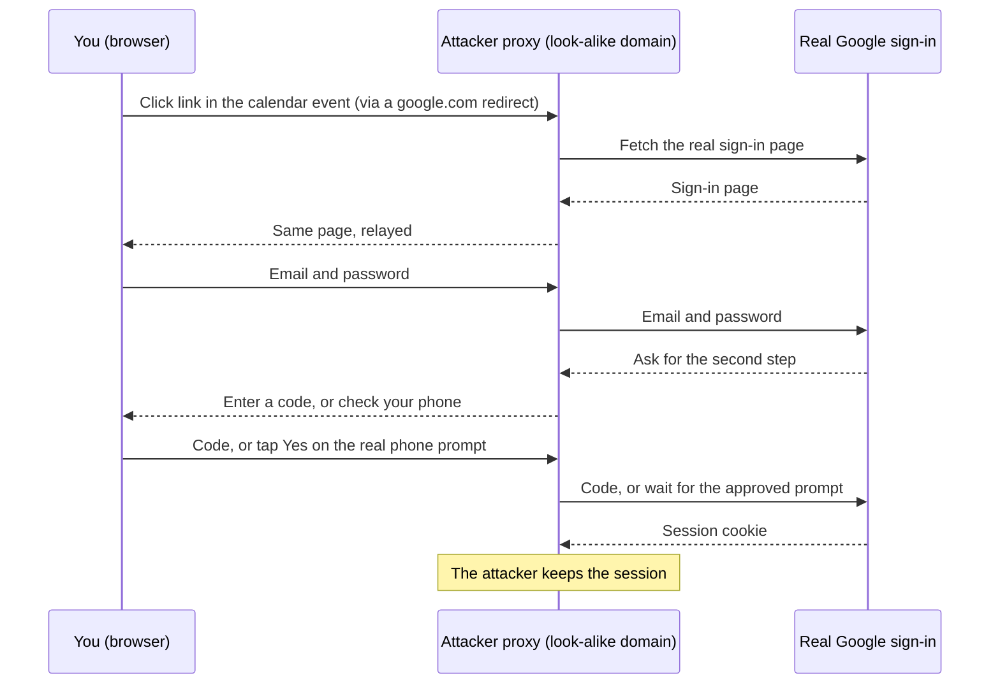

A Threads post about a Google Calendar phishing campaign went viral this week. Its advice was "don't click the link, type the URL yourself." That advice is correct, and worth keeping as a habit. So is a second one: when a link you just clicked asks you to sign in, treat the sign-in page itself as the warning, and ask why a meeting link wants your password before you give it.

Both habits share one weakness: they work only on the days you remember them. You open a meeting reminder from a client you know, late in the afternoon, between two calls. You click, you see the Google sign-in page you have seen a thousand times, and your hands do the rest. Everyone has foggy days, and a defence that holds only while you are alert will fail on one of them.

Many people also believe that two-factor authentication (MFA) covers this case. For this attack, most of it does not. So the useful questions are different ones: of Google's sign-in methods, which survive an attacker relaying the real page in real time? And which defences still work on a day when you are tired and click without looking?

## What the campaign does

Material Security named it "Operation CloudFire". What follows comes from secondary press coverage published 2026-11-04 and 2026-11-05; I have not read Material Security's primary report.

- The lure is a Google Calendar invitation, often sent from a real vendor or client whose mailbox the attacker already controls. The sender is genuine. Only the account is compromised.
- The event body contains a link that goes through Google's own redirector, so the URL you hover over starts with `google.com`.
- The redirect lands on an adversary-in-the-middle (AitM) reverse proxy, which shows you Google's real sign-in page by fetching it live from Google.
- Your password, your codes and your "Yes, it's me" taps are passed to Google as you enter them. Google issues a session to the proxy, and the attacker keeps it.
- Activity is reported since mid-August 2026, and the tooling is linked to a phishing kit called Nyasher.
- Google added a Workspace admin control on 2026-08-14 that restricts which invitations are added to Calendar automatically.

One point that the panic tends to skip: adding or accepting the invitation does not compromise your account. The harm comes from clicking the link and then signing in. Accepting does tell the sender your address is live, and the event's reminder will later put the same link in front of you again, at a time the attacker chose.

## The fake bank counter

Picture a bank counter set up in a shopping mall. It has the bank's logo and a friendly clerk. You hand over your ID and your PIN. The clerk phones the real bank, reads your details out, and repeats every question the bank asks back to you, word for word. When the bank says "come in", the clerk walks into the real branch beside you, and stays after you leave.

Everything you saw at the counter was real, because it was relayed from the real bank. That is why the page looks perfect.

Now compare two things you might show that clerk.

A verification code is a note. Whoever holds the note can use it, so the clerk reads it to the bank and it works.

A passkey is a key cut for the lock on the real bank's door. At the mall counter, there is no lock it fits. You cannot hand the key to the clerk, because your phone refuses to take it out anywhere except at the real door.

## How the relay works

The proxy does not need to understand MFA. It only needs to forward whatever you type, and whatever Google asks, in both directions, fast enough that you do not notice. A code that expires in 30 seconds is plenty of time for a machine.

### Why number matching does not help here

Google's phone prompt can ask you to tap the number that the sign-in screen is showing. That feature was built against prompt spam: an attacker who already has your password triggers prompts again and again while you are doing something else, until you tap Yes to make them stop. Number matching defeats that, because you have no screen showing a number.

In a relay, you do have a screen. You are signing in. Google shows a number to the proxy, the proxy shows the same number on its copy of the page, and you match it correctly. The prompt does show the device and location of the sign-in attempt, which would be the proxy's, but only if you stop to read it.

### Why passkeys and security keys do not relay

Passkeys and hardware security keys use WebAuthn. Each credential is bound to the domain of the site that created it. The check is done by your browser and operating system, which read the real address bar origin. The web page cannot fake that value.

So two things happen on the proxy's domain. First, the browser will not offer your Google passkey at all, because the domain does not match. Second, even if something got signed, the signed response contains the origin it was made for, and Google would reject a response made for the attacker's domain.

That is what the WebAuthn specification says should happen. I have not tested this attack against Google myself. I did try the safe half: with a Google passkey on my computer, I asked webauthn.io, a demo site for the specification, to sign me in. Neither my browser nor my password manager offered anything.

## The gaps a passkey leaves

A passkey on the account does not close everything. Four gaps remain.

1. **Downgrade.** The fake page can say "Passkey didn't work. Try another way" and steer you to password plus SMS, which relay perfectly. The rule to remember: if your fingerprint or face does not sign you in, and the page then asks you to switch methods, stop and close the tab.
2. **The phone prompt that asks for a fingerprint.** "Is it you trying to sign in?" on your phone may ask for your fingerprint before you tap Yes. That is still a Google prompt. It is not a passkey, and it relays.
3. **A fingerprint dialog drawn inside the page.** A web page can draw anything, including a picture of a system dialog. The real one comes from the browser or the operating system, outside the page.
4. **Malware and malicious browser extensions.** Code running on your machine sits outside this model entirely. This post does not cover it.

## Every Google method, against a relay

Google's 2-Step Verification options, as listed by university IT guides (I took this list from those guides, not from Google's own page): the Google prompt on your phone, authenticator app codes, SMS or voice codes, backup codes, passkeys, and security keys.

| Method | Survives a real-time relay? | Why |
|---|---|---|
| Password | No | Typed into the proxy and forwarded |
| SMS or voice code | No | A code is a note; anyone holding it can use it |
| Authenticator app code | No | Same as SMS, only harder to intercept in transit |
| Backup code | No | Same again |
| Google prompt on your phone | No | The fake page triggers a real prompt; the device and location shown are a warning only if you read them |
| Prompt with number matching | No | The proxy relays the number too; it defends against prompt spam |
| Passkey | Yes | Browser and OS refuse the wrong domain; the signed response names the origin |
| Hardware security key | Yes | Same WebAuthn binding |

This matches how US agencies classify MFA. CISA and NIST class only FIDO2/WebAuthn (passkeys and security keys) and certificate-based PIV/CAC smart cards as phishing-resistant. Everything else on the list above is MFA, and it is not phishing-resistant.

## Ranked by how much they need you to be alert

The engineering principle I care about here is the one we already apply to production systems: do not design on the assumption that people never make mistakes. Design so that the mistake cannot land. Ranked that way, the defences look like this.

| Defence | Alertness needed at the moment of the click | What it does |
|---|---|---|
| Passkey, with weak fallbacks removed (Google's Advanced Protection Program) | None | There is nothing relayable left to give the proxy |
| Passkey, with password and SMS fallbacks kept | Half | Holds, until a downgrade page asks you to try another way |
| Password manager autofill | Low | A tripwire: it will not fill on the wrong domain. A user on reflex often types the password in by hand anyway |
| Calendar set to add invitations only when you respond | Reduces lures | Fewer unknown events appear on your calendar; it blocks nothing once you click |
| Type the URL yourself, check the address bar | Full | Works only if you remember to do it, every time |
| Pause when a click leads to a sign-in page | Full | The right reflex to train; it fails on the day you are tired |

Keep the last two habits. They cost nothing and they catch a lot. Just do not make them the only layer, because the day they fail is the day you will not notice.

The Calendar setting lives under the personal Calendar settings for event invitations; I wrote its options from memory, so check the exact labels in your own settings. Workspace admins have the 2026-08-14 control for the same purpose at the organization level.

Advanced Protection has costs. From memory, and not verified for this post: account recovery becomes slower and stricter, and some third-party apps lose access to your Google data. Read Google's current description before you enrol.

## If you already signed in on one of these pages

1. Change your Google password.
2. Sign out every device you do not recognise at <https://myaccount.google.com/device-activity>.
3. Check that the recovery phone and recovery email on the account are still yours.

## Sources

- CISA, Implementing Phishing-Resistant MFA (fact sheet): <https://cisa.gov/sites/default/files/publications/fact-sheet-implementing-phishing-resistant-mfa-508c.pdf>
- NetManageIT, Google Calendar phishing campaign hijacks sessions, bypasses MFA: <https://blog.netmanageit.com/google-calendar-phishing-campaign-hijacks-sessions-bypasses-mfa/>
- Zepo, Calendar invite phishing: <https://zepo.ai/blog/calendar-invite-phishing-google-calendar-attack>
- UnderDefense, How AitM phishing bypasses MFA: <https://underdefense.com/blog/how-aitm-phishing-bypasses-mfa-and-why-phishing-resistant-mfa-would-have-stopped-it/>
